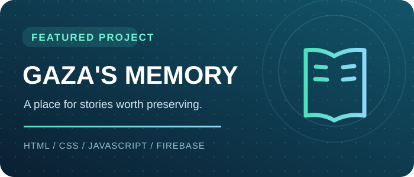
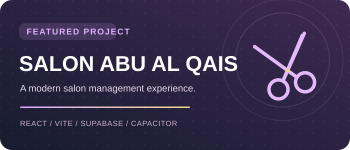

 

### 👨‍💻 Software Developer in the Making &nbsp; | &nbsp; 🔐 Cybersecurity Enthusiast

**Applied Information Technology Student • Gaza, Palestine 🇵🇸**

---

## ✨ Who am I?

Hi! I'm **Hadi Abu Aisha**, an Applied Information Technology student interested in building functional, polished applications and understanding the security behind them.

I love exploring **software development**, **web technologies**, and **cybersecurity**. I learn best by building real projects, experimenting, and improving my skills one step at a time.

- 💻 **I enjoy:** Java & JavaFX apps, modern websites, and practical solutions
- 🧠 **I'm exploring:** Python, JavaScript, React, and backend technologies
- 🛡️ **Security interests:** Web penetration testing, bug bounty, and secure development
- 🎯 **My mission:** Build software that is useful, reliable, and thoughtfully designed

## ⚡ Languages & technologies

**💻 Programming languages**

  

  

**🧩 Frameworks, databases & developer tools**

  

**🔐 Cybersecurity & research**

---

## 🚀 Featured projects

**📖 [Gaza's Memory Platform](https://github.com/HadiAbuAisha/Gaza-s-Memory-Platform)**

An interactive platform built to **preserve and share personal stories and memories from Gaza** — giving human experiences a lasting digital space.

  

**💈 [Salon Abu Al Qais](https://github.com/HadiAbuAisha/salon-abu-al-qais)**

A modern salon management application project designed around **appointments, customer management, and an intuitive user experience**.

---

## 📚 What I'm focused on

| 🧭 Area | 🔎 Current direction |
| :--- | :--- |
| ☕ **Java & JavaFX** | Object-oriented programming and desktop applications |
| 🌐 **Web development** | JavaScript, React, web applications and PHP fundamentals |
| 🐍 **Python** | Automation, problem-solving and practical scripts |
| 🛡️ **Cybersecurity** | Web security labs, responsible testing and vulnerability research |
| 🏗️ **Projects** | Turning ideas into useful, real-world applications |

## 📊 GitHub activity

 

---

### 🌟 Always learning. Always building.

*Curiosity drives the code. Purpose shapes the projects.*

📍 **Gaza, Palestine 🇵🇸**

